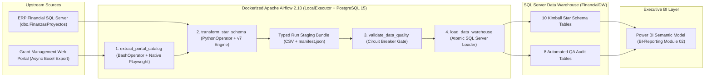
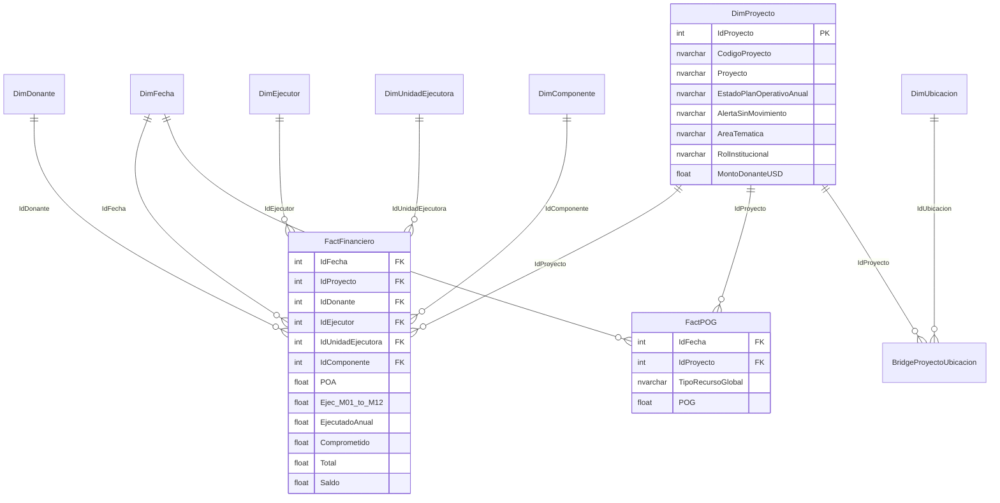

# Apache Airflow Financial Data Warehouse ETL Pipeline

Containerized Apache Airflow orchestration platform that automates daily extraction, Kimball Star Schema modeling, accounting reconciliation quality gates, and atomic SQL Server Data Warehouse loading for multi-year financial portfolio reporting.

> **Companion Repository:** This repository is the automated production orchestration evolution of [Module 02: Multi-Year Financial Portfolio BI & QA Engine](https://github.com/daivyb/BI-Reporting/tree/main/02-financial-portfolio-bi) in [daivyb/BI-Reporting](https://github.com/daivyb/BI-Reporting). Both repositories share the same 10-table Kimball Star Schema and 8-table automated QA reconciliation design.
>
> **Confidentiality Notice:** All institutional identifiers, tenant URLs, corporate emails, credentials, and real project budget records have been removed. The repository includes a 100% synthetic sample dataset (`data/sample/`) and an automated `pytest` verification suite so the full transformation, quality gate, and transactional loading logic can be validated locally without access to private databases or portals.

---

## System Architecture



---

## Orchestrated DAG Design (`financial_dw_etl_pipeline`)

Scheduled daily at `04:00` (`0 4 * * *`, `catchup=False`, `max_active_runs=1`) so executive Power BI dashboards refresh with verified financial and geographic data before business hours.

| Order | Task ID | Operator | Responsibility | Failure Protection |
|---|---|---|---|---|
| 1 | `extract_portal_catalog` | `BashOperator` | Runs headless Chromium via Playwright (`extract_portal_catalog.py`), authenticates into the grant portal, triggers asynchronous Excel generation using DOM attach + JS click, and saves the catalog to the run staging directory. | Captures timestamped full-page PNG + DOM HTML snapshots in `data/errors/` and retries up to 2 times. |
| 2 | `transform_star_schema` | `PythonOperator` | Extracts the 21-column multi-year ERP ledger from `sqlserver_source`, parses 5-level budget codes, applies configurable multi-donor project disaggregation (`SPLIT_PROJECT_CODES`), canonicalizes Spanish accents while preserving `Ñ`, computes dual `FactPOG`, flags inactive projects (`AlertaSinMovimiento`), maps Peruvian Ubigeos, and builds all 10 Star Schema + 8 QA tables. | Writes a lossless typed staging bundle (`CSV` + `manifest.json`) isolated by `{{ ts_nodash }}`. |
| 3 | `validate_data_quality` | `PythonOperator` | Circuit breaker (`data_quality.py`) validating schema completeness, non-empty core tables, primary key uniqueness across all 7 dimensions, 100% foreign key referential integrity, and zero `REVISAR` accounting variances in `QA_Cuadre` (tolerance `0.01`). | Raises `DataQualityError` before touching SQL Server DW, preserving the last known good dataset for Power BI. |
| 4 | `load_data_warehouse` | `PythonOperator` | Sanitizes pandas `NaN`/`NaT` values into native Python `None`, validates SQL identifiers, recreates all 18 DW tables (including empty QA tables so BI queries stay valid), and executes batched `pymssql` inserts inside a single database transaction. | Rolls back the entire transaction on any mid-load failure so Power BI never reads a partial refresh. |

---

## Target Kimball Data Warehouse Schema

The pipeline loads **10 analytical tables** and **8 QA audit tables** into SQL Server (`dbo` schema), maintaining exact structural parity with the Power BI semantic model documented in [BI-Reporting Module 02](https://github.com/daivyb/BI-Reporting/tree/main/02-financial-portfolio-bi/docs/data_dictionary.md).



**Persisted QA Audit Tables:** `QA_Cuadre`, `QA_NombresLimpieza`, `QA_RenombresEntreAnios`, `QA_SegmentosSinFila`, `QA_CodigosRaros`, `QA_Duplicados`, `QA_ProyectosSinUbicacion`, `QA_DepartamentosSinUbigeo`.

---

## Key Engineering Highlights

* **Zero Hardcoded Business Maps:** All project attributes (thematic area, institutional role, funding currency, donor agreement ceiling, operating plan status, and departments) are dynamically joined from the scraped grant portal catalog. Multi-donor umbrella codes are configured externally via `AIRFLOW_VAR_SPLIT_PROJECT_CODES`.
* **Native Playwright Architecture:** Playwright and Chromium are built natively into the Airflow Docker image, eliminating nested `DockerOperator` volume mount failures on Windows/WSL2 and removing the need to mount `/var/run/docker.sock`.
* **Hardened Docker Compose Topology:** Separates `airflow-scheduler` and `airflow-webserver` into dedicated containers with healthchecks, disables configuration exposure (`AIRFLOW__WEBSERVER__EXPOSE_CONFIG: 'false'`), and injects all database connections and portal credentials via `.env`.
* **Decoupled & Testable Python Core:** Pure transformation, typed staging serialization, data quality validation, and SQL Server loading logic are cleanly separated from Airflow hooks and verified by 17 automated `pytest` tests plus GitHub Actions CI.

---

## Quick Start

### 1. Run Automated Verification Locally (No Docker or SQL Server Required)

Verify the complete transformation engine, lossless staging roundtrip, Data Quality circuit breaker, `pymssql` `NaN`/`NaT` sanitization, transactional rollback behavior, and DAG integrity against the synthetic sample datasets:

```bash
git clone https://github.com/daivyb/Airflow.git
cd Airflow
pip install -r requirements-dev.txt
pytest -v
```

### 2. Deploy Full Apache Airflow Stack with Docker Compose

1. Create your local environment file from the template:
   ```bash
   cp .env.example .env
   ```
2. Edit `.env` with your SQL Server connections (`AIRFLOW_CONN_SQLSERVER_SOURCE`, `AIRFLOW_CONN_SQLSERVER_DW`), Airflow admin credentials, Fernet key, and grant portal variables (`AIRFLOW_VAR_PORTAL_*`).
3. Optional: bootstrap local development SQL Server databases (`FinancialSourceDB` and `FinancialDW`) with the synthetic 21-column sample ledgers:
   ```bash
   pip install pymssql pandas openpyxl pyxlsb
   python scripts/seed_dev_database.py --server localhost --port 1433
   ```
4. Build the Airflow + Playwright image and launch PostgreSQL, Airflow Init, Scheduler, and Webserver:
   ```bash
   docker compose up -d --build
   ```
5. Open `http://localhost:8080`, authenticate with the credentials configured in `.env`, enable **`financial_dw_etl_pipeline`**, and trigger a manual run.

### Daily Pause and Resume

Pause services without deleting the PostgreSQL metadata volume or rebuilding images:

```bash
docker compose stop
docker compose start
```

---

## Repository Structure

```text
.
├── .github/workflows/ci.yml              # GitHub Actions pytest pipeline
├── dags/
│   ├── financial_dw_etl_dag.py           # 4-task Apache Airflow DAG definition
│   └── scripts/
│       ├── extract_portal_catalog.py     # Headless Playwright portal extractor
│       ├── financial_transformer.py      # Pure Python v7 Kimball Star Schema + QA engine
│       ├── data_quality.py               # Automated Data Quality Gate (circuit breaker)
│       └── dw_loader.py                  # Atomic SQL Server pymssql loader & Airflow tasks
├── data/
│   ├── .gitkeep                          # Runtime staging and error artifact mount point
│   └── sample/                           # 100% synthetic multi-year ledgers & entity catalog
├── docs/
│   ├── architecture_and_troubleshooting.md  # ADRs & 6 production troubleshooting notes
│   └── deployment_runbook.md             # Sizing, security hardening & operational runbook
├── scripts/
│   └── seed_dev_database.py              # Env-driven local SQL Server bootstrap utility
├── tests/                                # 17 pytest unit, DQ, rollback & DAG integrity tests
├── Dockerfile                            # Apache Airflow 2.10.0 + FreeTDS + Chromium/Playwright
├── docker-compose.yaml                   # Hardened PostgreSQL + Scheduler + Webserver stack
├── .env.example                          # Sanitized environment variables template
├── pyproject.toml                        # Pytest configuration
├── requirements.txt                      # Container runtime Python dependencies
├── requirements-dev.txt                  # Local & CI test dependencies
└── LICENSE                               # MIT License
```

---

## Technical Documentation

* [Architecture Decisions & Production Troubleshooting](./docs/architecture_and_troubleshooting.md)
* [Production Deployment, Sizing & Operations Runbook](./docs/deployment_runbook.md)
* [Companion BI Reporting Layer (Power BI & DAX)](https://github.com/daivyb/BI-Reporting/tree/main/02-financial-portfolio-bi)

## License

This project is licensed under the [MIT License](./LICENSE).
